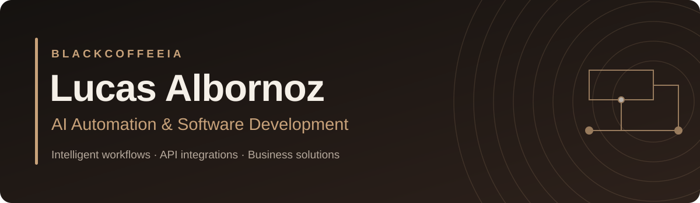

  

## 01 / About me

I'm Lucas Albornoz, a developer focused on AI automation and software development based in Argentina. I build workflows, AI-powered tools and business applications that connect APIs, language models and databases to simplify everyday operations.

My focus is on practical solutions: automating repetitive tasks, connecting business systems and turning ideas into maintainable software.

## 02 / Tech stack

**AI & automation**

**Development & data**

**Infrastructure & tools**

## 03 / Selected projects

Projects from my automation and development portfolio. Documentation and public releases are being prepared for the automation projects below.

| Project | Focus |
| --- | --- |
| AI Leads CRM | Lead classification, workflow automation and PostgreSQL persistence |
| Dental Clinic Automation | Email triage, FAQ handling and human escalation workflows |
| AI Job Search | Automated job discovery, deduplication and Telegram notifications |
| Restaurant Management System | Order management and WhatsApp integration; in development |
| [Collaborative Marketplace](https://github.com/BlackCoffeeIA/marketplace-colaborativo) | Collaborative web application with product API documentation |

## 04 / What I build

- AI-assisted workflows and business process automation
- API integrations, webhooks and intelligent assistants
- Web applications and operational dashboards
- Data-driven systems with relational databases

## 05 / Connect

---

BLACKCOFFEEIA · Building intelligent solutions.

