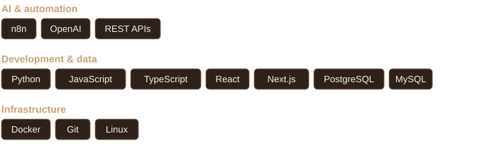

  

## About me

I'm a developer focused on AI automation and software development. I enjoy solving real business problems, simplifying complex processes and building systems that are useful beyond the prototype.

I'm particularly interested in how AI can improve everyday operations and make software more effective.

## Tech stack

## Projects

- **AI Leads CRM** — A workflow for capturing and classifying leads, keeping track of interactions and storing data in PostgreSQL.
- **Dental Clinic Automation** — An email assistant that handles common questions and routes urgent or complex messages to staff.
- **Job Search Automation** — A workflow that finds job listings, filters duplicates and sends notifications through Telegram.
- **Restaurant Management System** — Currently working on a dashboard for managing orders and WhatsApp conversations.
- **[Collaborative Marketplace](https://github.com/BlackCoffeeIA/marketplace-colaborativo)** — A web development project with a product API.

I'm preparing the repositories and documentation for the automation projects before making them public.

---

**BlackCoffeeIA**
